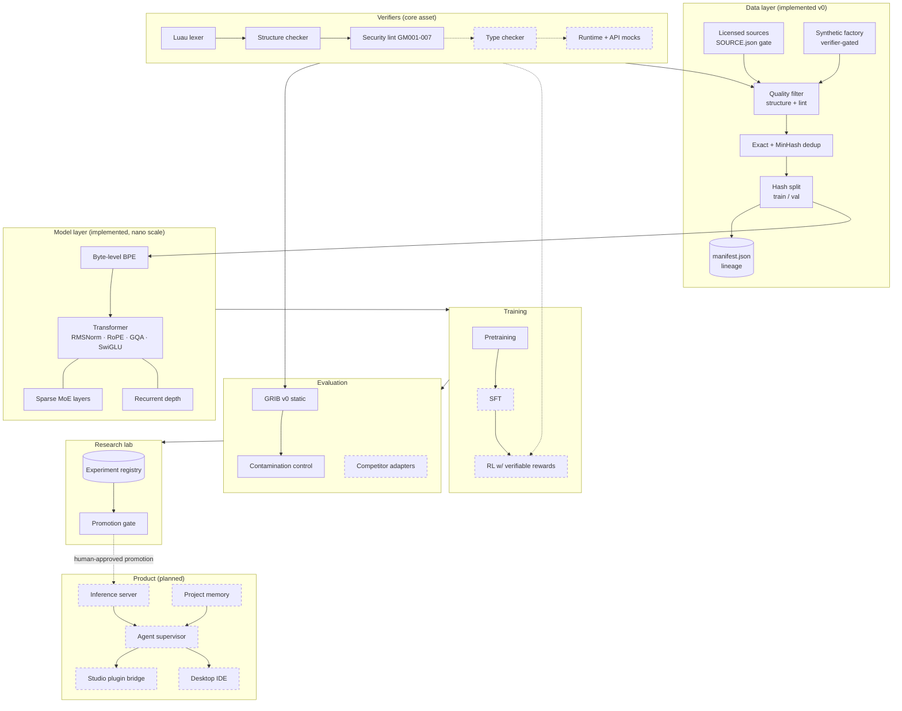
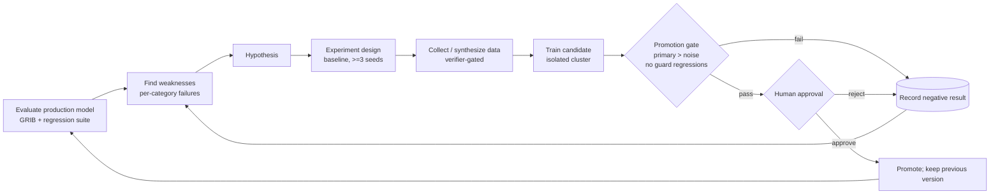
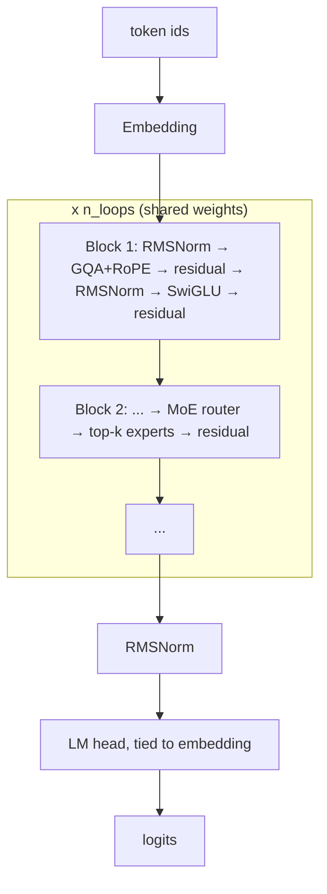
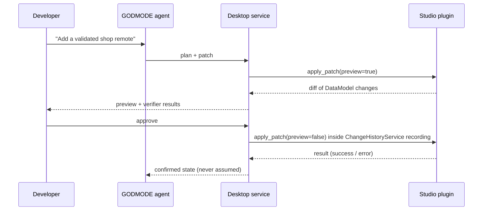
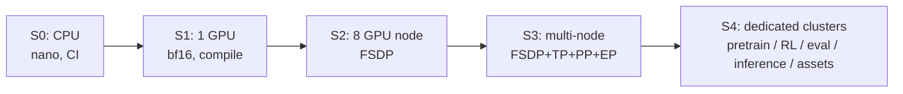

# System Architecture Diagrams

Mermaid diagrams (render on GitHub). Solid boxes exist today; dashed boxes are planned.

## 1. Whole system

## 2. Continuous improvement loop

## 3. Model block

## 4. Studio integration (planned)

## 5. Infrastructure scaling path

